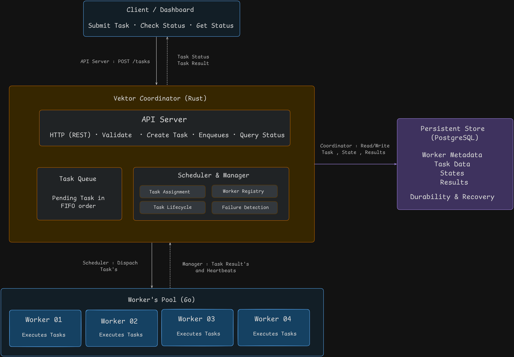

# Vector Architecture

Vector is a distributed task queue and execution engine built using **Rust, Go, and TypeScript**. It distributes tasks across multiple workers, manages execution, and tracks task states.

## 1. Client / Dashboard (TypeScript)

The interface through which users interact with Vector.

- Submit tasks via `POST /tasks`.
- Check task execution status.
- Retrieve task results.

## 2. Vector Coordinator (Rust)

The central component responsible for managing tasks, scheduling execution, and coordinating workers.

### API Server

- Exposes HTTP REST endpoints for client communication.
- Validates incoming requests, including each task's time limit, and creates tasks.
- Enqueues tasks and handles status queries.

### Task Queue

- Stores pending tasks in **FIFO (First-In, First-Out)** order.
- Provides queued tasks to the scheduler for execution.

### Scheduler & Manager

- **Task Assignment:** Selects available workers and dispatches tasks.
- **Worker Registry:** Maintains worker information, availability, and capacity.
- **Task Lifecycle:** Tracks task states, execution results, and failures.
- **Failure Detection:** Monitors worker heartbeats and detects unresponsive workers.

## 3. Worker Pool (Go)

A collection of independent workers responsible for executing tasks assigned by the coordinator.

- Receives tasks from the scheduler.
- Executes assigned tasks and stops them at the requested time limit.
- Tracks assigned, unfinished task IDs in `task_assigned` and clears them when each task finishes.
- Reports execution results and failures.
- Sends periodic heartbeats to the coordinator.

Workers may run on different machines, enabling distributed execution.

## 4. Persistent Store (PostgreSQL)

Provides durable storage for task and worker information.

- **Task Data:** Submitted tasks and associated metadata.
- **Task States:** Execution status of individual tasks.
- **Results:** Outputs produced by completed tasks.
- **Worker Metadata:** Information about registered workers.
- **Recovery:** Supports restoring task state after failures.

## 5. Task Execution Flow

1. Client submits a task to the API Server.
2. API Server validates and enqueues the task.
3. Scheduler retrieves the pending task from the FIFO queue.
4. Scheduler selects an available worker.
5. Worker executes the task and reports its result.
6. Coordinator updates task state in PostgreSQL.
7. Client retrieves task status or results through the API.

## Communication

| Communication | Mechanism |
|---|---|
| Client → Rust API | HTTP REST |
| API → Task Queue | Rust function call |
| Task Queue → Scheduler | Shared state / async channel |
| Scheduler → Go Worker | HTTP or gRPC |
| Go Worker → Coordinator | HTTP or gRPC |
| Coordinator → PostgreSQL | Database driver |
